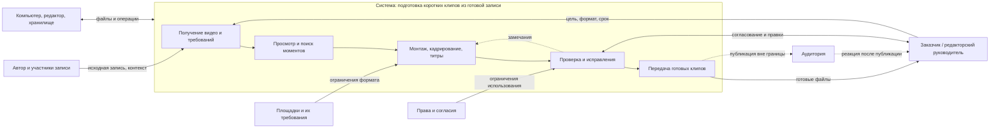

# Лабораторная работа № 1. Границы и цель системы

**Тема:** нарезка длинного видео на короткие клипы
**Объект анализа:** существующий рабочий процесс автора или небольшой команды, которая вручную готовит короткие ролики из уже записанного длинного видео.

## 1. Описание системы

Система нарезки видео на короткие клипы — это повторяющийся процесс, в котором автор или редактор получает готовую длинную запись, находит в ней подходящие фрагменты, превращает их в короткие ролики и передаёт заказчику или публикующему специалисту. Процесс существует, чтобы переиспользовать содержательные моменты записи для коротких форматов без повторной съёмки. В работе могут участвовать редактор, автор исходного видео и ответственный за публикацию; используются видеоредактор, хранилище файлов и правила площадок. Здесь рассматривается именно текущая практика, а не проектирование нового приложения.

## 2. Граница системы

**Внутри:** получение исходника и требований; просмотр и поиск фрагментов; выбор моментов; монтаж; кадрирование под формат; добавление титров и субтитров; экспорт; проверка и исправление; передача готовых файлов.

**Среда:** автор и участники исходной записи; заказчик или редакторский руководитель; площадки публикации и их меняющиеся форматы; аудитория; права на музыку и изображение; компьютер, программное обеспечение, сеть и хранилище. Они влияют на процесс, но не являются его этапами.

**За границей:** производство исходной длинной записи, продвижение опубликованных роликов и реакция аудитории после публикации. Их результаты могут повлиять на будущие требования, но в этой работе они не управляются процессом нарезки.

**Спорные элементы:**

- Согласование выбранных фрагментов включено: оно может вернуть ролик на монтаж и меняет объём работы.
- Загрузка на площадку не включена: рассматривается передача готового файла ответственному за публикацию. Если редактор сам публикует ролики, границу следует расширить.
- Автоматические инструменты транскрибации или поиска фрагментов, если ими пользуются, входят в систему как рабочие средства. Их внутреннее устройство находится за границей.
- Обратная связь аудитории находится снаружи; решение использовать её при следующей нарезке относится к требованиям следующего цикла.

## 3. Заинтересованные стороны

| Сторона | Роль и чего хочет | Возможный конфликт |
|---|---|---|
| Автор исходного видео | Получить точное представление своих слов и не тратить время на повторные согласования | Ему важны контекст и точность, тогда как заказчику может быть важнее динамика ролика |
| Редактор / монтажёр | Выпускать клипы предсказуемого качества в разумный срок и без лишних переделок | Срочность и большой объём могут конфликтовать с тщательной проверкой |
| Заказчик / редакторский руководитель | Получить нужное число клипов к сроку, в требуемом стиле и с подходящими моментами | Может менять критерии или просить дополнительные правки после монтажа |
| Ответственный за публикацию | Получить файлы, которые подходят площадке и готовы к загрузке | Может обнаружить ограничения формата уже после завершения монтажа |
| Участники исходной записи и правообладатели | Чтобы изображение, голос и материалы использовались согласованно | Популярный фрагмент не всегда допустимо публиковать |
| Зрители коротких роликов | Быстро понять смысл клипа, увидеть читаемые титры и услышать разборчивую речь | Сокращение ради темпа может убрать важный контекст |

## 4. Цель и признаки достижения

**Цель системы:** к согласованному сроку передать заказчику требуемую партию коротких клипов из исходной записи так, чтобы клипы соответствовали согласованным содержательным, техническим и правовым требованиям и не требовали повторного монтажа из-за предотвратимых ошибок.

Цель проверяется по наблюдаемым данным конкретной партии:

- доля клипов, принятых с первого предъявления;
- число циклов правок на клип и причины возвратов;
- время от получения исходника и требований до передачи принятой партии;
- доля клипов, переданных к согласованному сроку;
- число замечаний по формату, субтитрам, контексту и правам.

Значения и пороги нужно согласовать с тем, кто управляет процессом: без исходных данных нельзя обоснованно назначить норматив. Рост скорости сам по себе не означает достижения цели, если одновременно растут ошибки или возвраты.

## 5. Записка: предварительный разбор и наблюдения

### Цель системы

Рассматриваемая система — не видеоредактор и не будущий сервис, а работа людей по превращению готовой длинной записи в согласованный набор коротких клипов. Её граница проходит от получения исходника и требований до передачи принятой партии. Так видны основные причины задержек и переделок, но анализ не расползается на съёмку, продвижение и поведение аудитории.

Цель не сводится к «быстрому монтажу»: короткий срок бесполезен, если клипы приходится возвращать из-за потерянного контекста, нечитаемых субтитров или неподходящего формата. Поэтому результат следует оценивать одновременно по сроку передачи, доле приёмки с первого раза и причинам повторных правок. Пороговые значения нельзя выбрать без наблюдения за конкретным процессом и разговора с его руководителем.

### Три наблюдения

1. В задании указаны тема и число роликов, но не конкретные моменты. Редактор просматривает исходник, отдельно записывает таймкоды кандидатов, а затем возвращается к каждому фрагменту, чтобы проверить контекст. Неожиданно, что поиск материала идёт отдельным циклом и не заканчивается в момент нахождения удачной реплики.
2. При первом экспорте выясняется, что стиль субтитров и безопасные отступы для вертикального кадра заранее не согласовали. Приходится менять оформление и повторно экспортировать клипы, хотя сами выбранные фрагменты не изменились. Неожиданно, что недостающие требования создают переделку уже после монтажа.
3. В обратной связи заказчик пишет «сделать динамичнее», не указывая таймкод или конкретную правку. Редактору приходится повторно просматривать ролики и самостоятельно решать, где сократить паузу. Неожиданно, что формально короткий комментарий не сокращает работу, а переносит решение о критерии качества к редактору.

###  решения

1. **Упорядочить поиск фрагментов.** Во время первого просмотра вести общий список кандидатов: таймкод начала и конца, краткий смысл, необходимый контекст и статус согласования. Перед монтажом отправлять заказчику список на выбор, если решение о содержании принимает он.
2. **Согласовать оформление до монтажа всей партии.** В брифе указывать площадку и соотношение сторон, стиль и размер субтитров, безопасные отступы, а также требования к экспорту. Сначала подготовить один пробный клип и получить подтверждение шаблона, затем применять его к остальным.
3. **Сделать обратную связь адресной.** Просить заказчика указывать номер клипа или таймкод, конкретное изменение и причину. Например: «Клип 2, 00:14: сократить паузу перед ответом, чтобы быстрее перейти к основной мысли». Если комментарий вроде «сделать динамичнее» остаётся неоднозначным, уточнить критерий до внесения правок.
