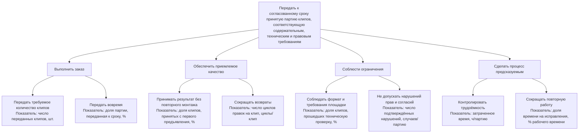

# Лабораторная работа № 2. Структура и дерево целей

**Тема:** нарезка длинного видео на короткие клипы  
**Объект анализа:** существующий рабочий процесс автора или небольшой команды, которая вручную готовит короткие ролики из уже записанного длинного видео.  
**Граница системы:** от получения исходника и требований до передачи заказчику принятой партии клипов. Производство исходной записи и публикация роликов не входят в систему.

## 1. Декомпозиция системы

### 1.1. По функциям (что делает система)

1. **Принять исходник и требования.** Получить видео, число и назначение клипов, сроки, площадки, технические ограничения и критерии согласования.
2. **Найти и отобрать фрагменты.** Просмотреть запись, отметить таймкоды кандидатов, проверить контекст и согласовать выбор с заказчиком.
3. **Смонтировать клипы.** Сократить фрагменты, кадрировать видео, оформить субтитры и подготовить пробный клип или шаблон.
4. **Проверить и исправить.** Сверить содержание, читаемость, формат и права; получить замечания, внести правки и повторно проверить результат.
5. **Экспортировать и передать партию.** Подготовить файлы в согласованных параметрах и передать их ответственному за публикацию.

### 1.2. По составу (из каких элементов состоит система)

- **Люди:** редактор/монтажёр выполняет поиск, монтаж и проверку; заказчик или редакторский руководитель задаёт требования, выбирает фрагменты и принимает работу; автор исходника помогает проверить контекст и точность высказываний; ответственный за публикацию сообщает ограничения площадки и принимает файлы.
- **Информация:** исходная видеозапись; бриф и срок; список фрагментов с таймкодами и контекстом; согласованный образец оформления; комментарии и статусы правок; требования площадки и подтверждения прав.
- **Инструменты и ресурсы:** компьютер, видеоредактор, средства транскрибации или поиска (если используются), хранилище файлов, время участников и канал передачи файлов.
- **Правила и критерии:** требования к содержанию и длительности; параметры кадра и экспорта; правила субтитров; порядок согласования; ограничения на использование изображения, голоса и материалов.
- **Результат:** переданная заказчику партия принятых коротких клипов и связанные с ней статусы согласования.

### 1.3. Сравнение декомпозиций

Декомпозиция по функциям показывает последовательность работы, точки возврата и места, где возникают ожидание или переделка: например, неуточнённые требования могут обнаружиться уже при экспорте. Декомпозиция по составу показывает, от кого зависят решения и какие входы нужны каждой функции: без требований площадки редактору приходится выбирать оформление самому, а без адресных замечаний — повторно искать место для правки. Первая отвечает на вопрос «как проходит работа», вторая — «кто и с чем обеспечивает её выполнение». По одной только цепочке функций были бы не видны распределение полномочий и нехватка входной информации.

## 2. Дерево целей

Листья дерева измеримы, но целевые значения нельзя честно назначить без данных о нескольких партиях и согласования с заказчиком. Для измерения доли приёмки нужно считать клипы, принятые без повторного монтажа, относительно всех переданных клипов. Доля своевременной передачи — число клипов, переданных не позже согласованного срока, делённое на число клипов в заказе. Время на исправления фиксируется отдельно от первичного монтажа. Техническую проверку проводят по заранее согласованному списку требований, а не по субъективному впечатлению.

## 3. Конфликт целей

Конфликтуют **скорость передачи партии** и **качество/приёмка с первого раза**. Если сократить время на проверку контекста, субтитров и параметров экспорта, редактор может быстрее отдать первую версию, но возрастает вероятность возвратов и повторного экспорта. Тогда суммарное время до принятой партии может даже увеличиться. Обратная крайность — многократное согласование каждого фрагмента — повышает уверенность в содержании, но задерживает выпуск. Сейчас спор решается совместно: заказчик или редакторский руководитель задаёт приоритеты, объём и срок, а монтажёр оценивает необходимое время и сообщает о рисках качества. Если срок и требования несовместимы, заказчик должен выбрать, что изменить: срок, объём партии или глубину проверки.

## 4. Какая ветка проседает и откуда это известно

Предварительно проседает ветка **«сделать процесс предсказуемым»**, особенно подготовка требований и обратной связи до монтажа. В наблюдениях из первой лабораторной работа начинается без выбранных таймкодов, при первом экспорте выясняется, что стиль субтитров и безопасные отступы не согласованы, а замечание «сделать динамичнее» не указывает клип или таймкод. Эти ситуации приводят к дополнительному поиску, повторному экспорту и неоднозначным правкам. Это качественные свидетельства из описанного рабочего процесса, а не статистика по реальным партиям: нельзя утверждать, насколько велика проблема в процентах или часах. Чтобы подтвердить вывод, для следующих партий нужно фиксировать время поиска и исправлений, циклы правок на клип, причины возвратов и долю приёмки с первого предъявления.

## 5. Почему дерево остановлено на этом уровне

На каждом листе уже указан показатель и единица измерения; дальнейшая детализация потребовала бы перейти от целей процесса к конкретным действиям или настройкам инструментов. Например, показатель «доля клипов, принятых с первого предъявления» можно разложить по причинам возврата, если журнал замечаний покажет, что это необходимо. Сейчас такой статистики нет, поэтому более глубокое дерево создало бы видимость точности без достаточных данных.
